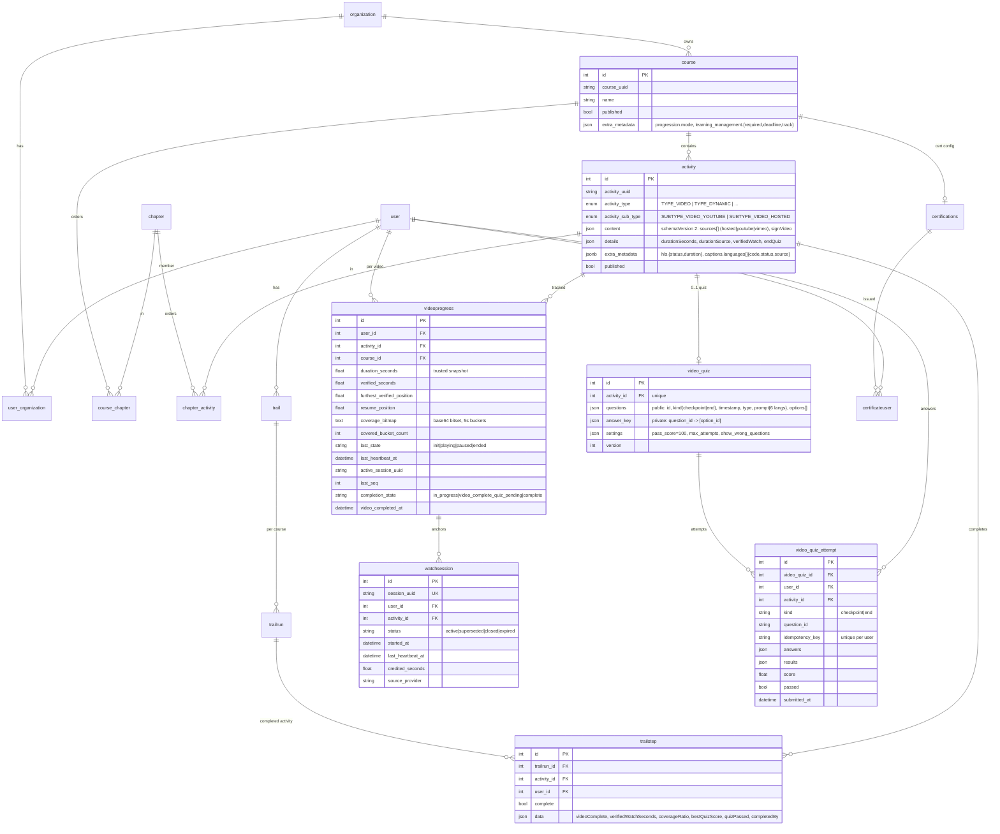

# WYD SEOUL 2027 LMS — 데이터 모델 (ERD)

LearnHouse 스키마 위에 WYD 봉사자 교육센터가 추가·활용하는 테이블을 정리한다.
기획 문서(devnote §04)의 `courses → videos → quizzes/quizKeys`, `progress`, `watchSessions`,
`certificates` 개념이 아래와 같이 매핑된다.

| 기획 문서 개념 | 이 저장소의 테이블 | 비고 |
|---|---|---|
| `users/{uid}` (프로필·운영 등급) | `user`, `user_organization`, `role`, `usergroup*` | 권한은 역할(RBAC), 운영 등급은 usergroup으로 표현 |
| `courses/{courseId}` | `course` (+ `course.extra_metadata.learning_management`, `progression`) | 필수/선택·마감일·순차 잠금 플래그는 JSON 메타데이터 |
| `videos/{videoId}` (차시) | `activity` (`TYPE_VIDEO`, `content.sources[]`, `details.durationSeconds`, `details.verifiedWatch`) | 차시 = activity; chapter/course_chapter 로 순서 |
| `quizzes` / `quizKeys` | `video_quiz.questions` (공개) / `video_quiz.answer_key` (비공개) | 한 행 안에서 컬럼 분리; 학습자 API는 공개 투영만 반환 |
| `progress/{uid}_{videoId}` | `videoprogress` (user×activity 유니크) + `trailstep` (완료 확정) | 검증 시청시간·고유 구간·완료 상태 |
| `watchSessions` | `watchsession` | 사용자×영상당 활성 세션 1개 |
| `quizAttempts` | `video_quiz_attempt` | 체크포인트·종료 퀴즈 시도 기록, 멱등키 |
| `certificates` | `certifications`, `certificateuser` | 코스 완료 시 서버 발급 |
| `integrationOutbox` | `webhook_*` (HMAC 서명, 재시도, 전송 로그) | 물류시스템 전달은 웹훅 이벤트 |
| `analyticsEvents` | analytics `track()` 이벤트 (`video_completed`, `course_completed`, …) | |

## ER 다이어그램



## 완료 판정 흐름

```
startWatchSession ─► recordWatchHeartbeat ×N ─► (서버) verified ≥ 90% AND coverage ≥ 90%
                                                   │
                     endQuiz 없음 ─────────────────┴─► complete_activity_for_user ─► trailstep(complete)
                     endQuiz 있음 ─► video_complete_quiz_pending ─► submit_end_quiz(100점) ─► trailstep(complete)
                                                                                      │
                                                   모든 published activity 완료 ──────┴─► certificateuser 발급,
                                                                                            course_completed 웹훅,
                                                   모든 필수 과정 완료 ──────────────────► all_required_courses_completed 웹훅(물류)
```

## 운영 규모 메모 (동접 5,000 / DAU 10,000)

* 영상 전송은 YouTube(일부 공개)가 담당 → CDN 비용 0. 자체 업로드/Vimeo는 DR 백업.
* 핵심 쓰기 부하 = 하트비트: 5,000 동접 × 10초 ≈ 500 req/s, 요청당 `videoprogress` 1 UPDATE + `watchsession` 1 UPDATE (PK 기준).
  분석 이벤트는 완료 시 1회만. 서버 정책값(`HEARTBEAT_SECONDS`) 하나로 간격을 20~30초로 늘릴 수 있다.
* 인덱스: `videoprogress(user_id, activity_id)` 유니크, `(course_id, user_id)`, `(activity_id, completion_state)`, `(org_id, updated_at)`;
  `watchsession(user_id, activity_id, status)`. 세션 행은 TTL(배치 삭제)로 정리 가능.
